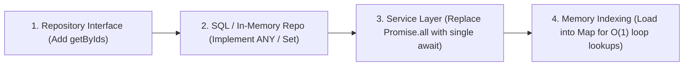

# Service Repository Batch Query Optimizer

## Overview
A pervasive database bottleneck in microservices and domain-driven architectures is firing concurrent or iterative individual database queries for each item in a collection:
- `Promise.all(uniqueIds.map(id => repo.getById(tenantId, id)))`
- `for (const item of items) { await repo.getById(item.id); }`

While `Promise.all` runs concurrently, it creates an $\mathcal{O}(N)$ connection burst that can easily exhaust database connection pools (Postgres `max_connections`), trigger connection timeout errors, and multiply round-trip network latency.

This skill audits backend service layers across TypeScript, PHP, and Python, identifies N+1 query anti-patterns, and standardizes refactoring into single batched repository lookups (`getByIds`, `getAccountsByNumbers`) backed by parameterized SQL (`WHERE id = ANY($1)` or `WHERE id IN (...)`) combined with in-memory $\mathcal{O}(1)$ `Map` indexing.

---

## Dependencies
- **Python 3.8+** (for running the CLI audit tool)
- Target backend runtime (Node.js/TypeScript, PHP/Laravel, Python/FastAPI)

---

## Quick Start

### 1. Audit Service Files for N+1 Query Loops
Scan an individual service file or an entire `src/services` directory:
```bash
python C:/Users/johns/.gemini/config/skills/service-repository-batch-query-optimizer/scripts/batch_query_auditor.py scan \
  --target src/services \
  --output batch_query_audit.json
```

### 2. View Canonical Batched Repository Patterns
Print reference architectures for interface, in-memory repository, PostgreSQL parameterized repository, and service caller:
```bash
python C:/Users/johns/.gemini/config/skills/service-repository-batch-query-optimizer/scripts/batch_query_auditor.py pattern
```

---

## Standard 4-Step Refactoring Protocol



### 1. Extend Repository Interface
```typescript
export interface IAccountingRepository {
  getAccountByNumber(tenantId: string, accountNumber: string): Promise<GlAccount | null>;
  // ⚡ Batched retrieval
  getAccountsByNumbers(tenantId: string, accountNumbers: string[]): Promise<GlAccount[]>;
}
```

### 2. Implement in Memory & SQL Repositories
**In-Memory Repository**:
```typescript
async getAccountsByNumbers(tenantId: string, accountNumbers: string[]): Promise<GlAccount[]> {
  const numbersSet = new Set(accountNumbers);
  return Promise.resolve(this.accounts.filter(a => numbersSet.has(a.accountNumber)));
}
```

**PostgreSQL Repository**:
```typescript
async getAccountsByNumbers(tenantId: string, accountNumbers: string[]): Promise<GlAccount[]> {
  if (accountNumbers.length === 0) return [];
  return withTenantTransaction(tenantId, async (client) => {
    const res = await client.query(
      'SELECT * FROM accounts WHERE tenant_id = $1 AND account_number = ANY($2)',
      [tenantId, accountNumbers]
    );
    return res.rows.map(mapRowToAccount);
  });
}
```

### 3. Refactor Domain Service Caller
```typescript
// ❌ BEFORE (N+1 concurrent queries)
const uniqueAccountNumbers = new Set(payload.lines.map(l => l.accountNumber));
const fetchedAccounts = await Promise.all(
  Array.from(uniqueAccountNumbers).map(num => this.getAccountByNumber(tenantId, num))
);

// ✅ AFTER (1 batched query)
const uniqueAccountNumbers = Array.from(new Set(payload.lines.map(l => l.accountNumber)));
const fetchedAccounts = await this.getAccountsByNumbers(tenantId, uniqueAccountNumbers);

// Index into Map for O(1) iteration access
const accountMap = new Map();
for (const acct of fetchedAccounts) {
  accountMap.set(acct.accountNumber, acct);
}
```

---

## CLI Reference (`batch_query_auditor.py`)

### `scan`
* `--target`: Path to a service file or directory.
* `--output`: Optional JSON file path for audit findings.

### `pattern`
* `--output`: Optional JSON file path to dump boilerplate code examples.

---

## Common Mistakes
1. **Fetching the Entire Table**: Resolving N+1 by calling `getAll()` or `getAccounts()` without filtering is an anti-pattern that creates massive memory bloat in production.
2. **Missing `ids.length === 0` Guard**: In SQL queries, executing `WHERE id = ANY($1)` with an empty array can return an empty result or cause syntax errors depending on database driver; always short-circuit when input array is empty.
3. **Unindexed Array Search After Batch Fetch**: Calling `.find(a => a.id === line.id)` inside a loop over fetched records reverts algorithmic performance to $\mathcal{O}(N \times M)$. Always load fetched records into a `Map` first.
